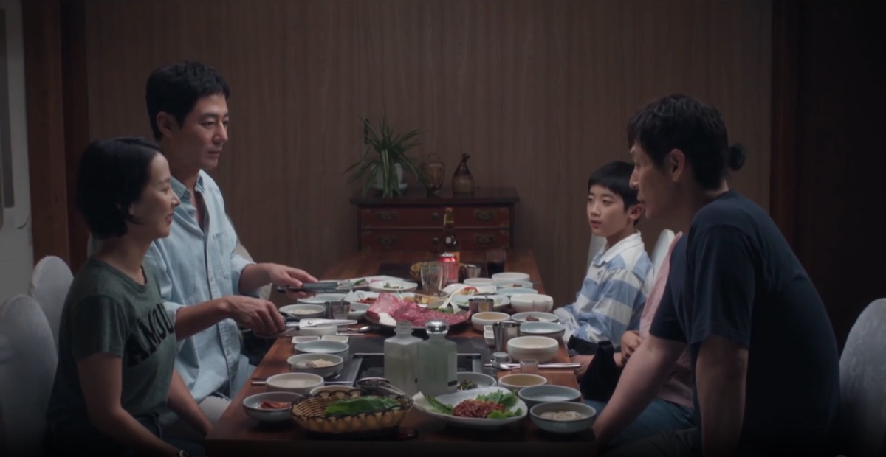
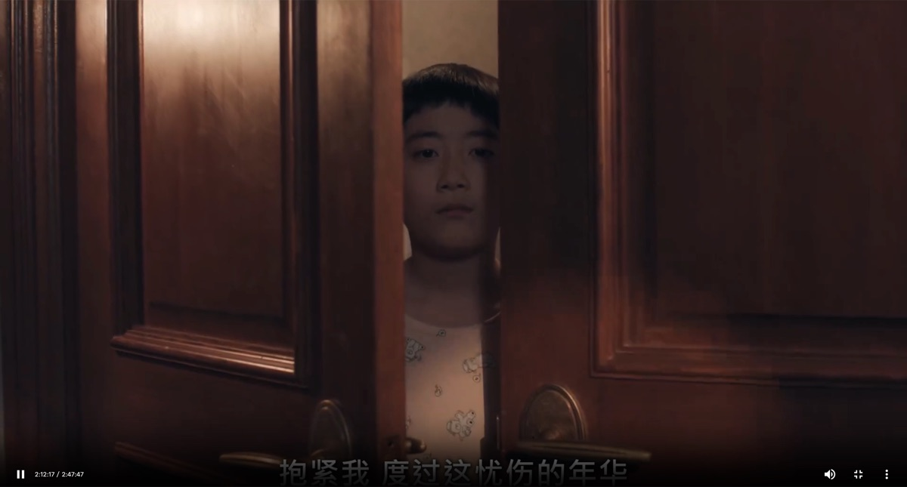
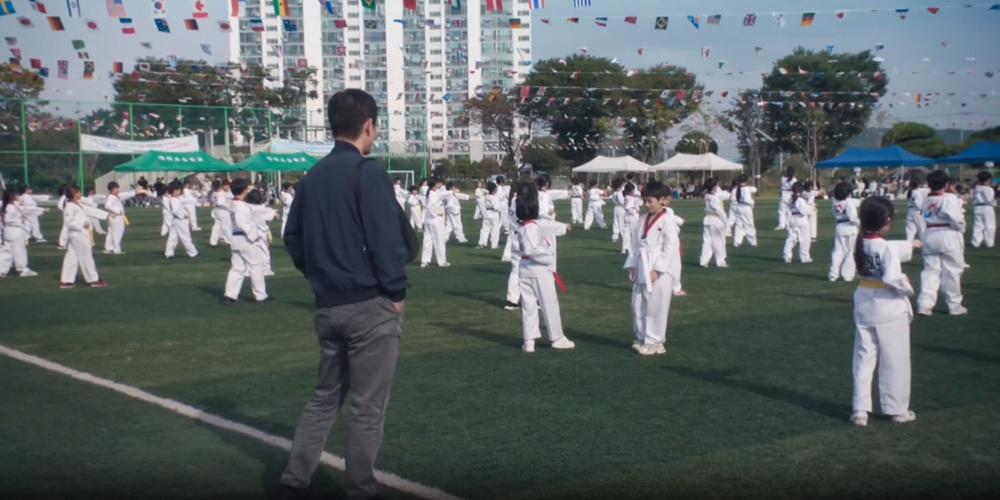
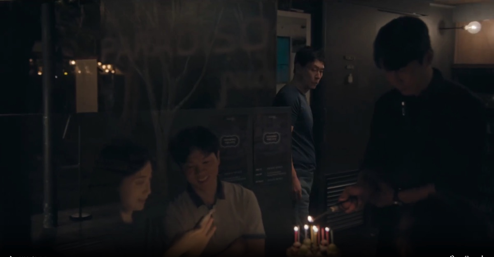
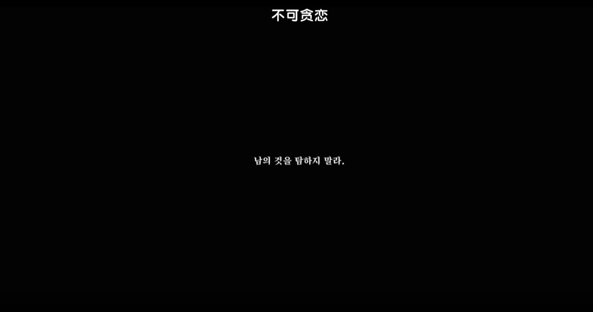
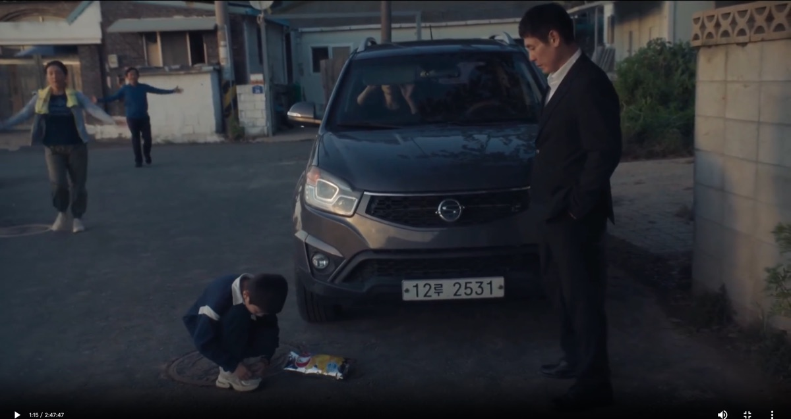
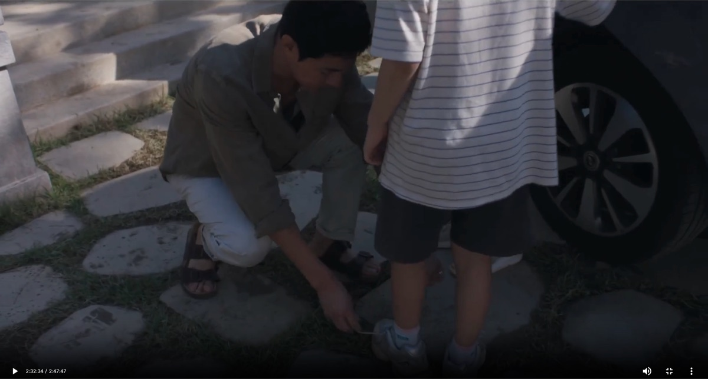

<link rel="stylesheet" href="{{ "/assets/css/film-details.css" | relative_url }}">

# 读李沧东

> 看《可能的爱》有感
>
> 用“读”这个词，是因为我觉得李沧东先是一个诗人、作家，其次才是一个导演。
>
> 这篇文章其实从上周日就开始写了，写了一下午，但是一直觉得写得很不好，所以也没有发。尝试用AI去修，发现越修越糟糕。今天就觉得，不管好与坏都要发出来了。

### 一、两种极端

我一直喜欢两类电影，一类是极度放纵的表达，一类是极度克制的表达。

《路边野餐》我连续看了两遍，看完觉得毕赣是个天才。

《一步之遥》看完，我觉得姜文是为自己拍了一部电影，完全不在意观众的评价。“我就是要这样拍，你管得着吗？”

在另一个极端，我喜欢李沧东。

### 二、李沧东的克制

我觉得，李沧东的克制，最重要的是他的留白。

他的作品不像其他导演那样旗帜鲜明地表达观点，更多的是给你留白，让你自己去感受不一样的答案。

对音乐，他也一直是能不用就不用。《诗》全片几乎没有配乐。在2024年的一次访谈中，李沧东说，《诗》原本制作过配乐，但在最后混音时全部删掉了。他希望观众直接从场景中感受到音乐性：风声、雨声、汽车声、孩子们的说话声。

#### 八年前的《燃烧》

最接近金棕榈奖的《燃烧》，也是最让我觉得李沧东似乎没有那么克制的作品。

相比《诗》和《密阳》，《燃烧》更直接地呈现了阶级冲突和年轻人的愤怒。我甚至怀疑，李沧东是不是刻意收起了一部分克制，想用《燃烧》获得一座金棕榈。

可惜2018年的金棕榈还是被是枝裕和的《小偷家族》拿走了。第二年，《寄生虫》获得金棕榈，奉俊昊做到了李沧东没做到的事情。

《寄生虫》把阶级矛盾直接摆到了台面上，但《燃烧》最后还是一如既往的李沧东风格，把阶级冲突变成了怀疑：钟秀究竟发现了Ben的罪行，还是因为嫉妒、阶级愤怒和自身的挫败感，逐渐相信Ben有罪？

这也是《燃烧》最后留给观众的克制。我甚至觉得，这就是它离金棕榈半步之遥的原因。

所以，金棕榈真的有那么重要吗？

### 三、文字自有重力

李沧东对音乐的态度，也解释了我多年来的一个困惑：小时候我明明很喜欢诗，却很讨厌朗诵诗。

所有人都告诉我要“饱含感情”，抑扬顿挫地去朗诵诗。但我始终不愿意用刻意的声调，去读那些自己喜欢的诗。

直到最近一年，我似乎才想明白为什么。

刻意的发声，本身是对诗歌感情的折损。

音乐确实可以让一个原本平静的画面变得悲伤，抑扬顿挫的朗诵者确实也可以让一句诗立刻变得悲壮或激昂。

可是这样一来，我们的感受是否是真实的？在某种程度上，这些感受似乎是被刻意制造、引导产生的。

我想，真正有生命力的情绪，是观众从作品中自己感受到的。

### 四、回到《可能的爱》

《可能的爱》依然有着李沧东式的叙事结构、诗意、克制与留白。

有阶级矛盾，有婚姻与爱情，可能也有我们如何观看、记录和讲述另一个人的痛苦。

李沧东在采访中说，他不喜欢刻意通过电影传达某种信息，也始终努力保持一种态度：不认为自己掌握答案。

每个人都可以对这部电影有自己的理解。

你可以看到电影呈现出来的东西，也可以看到那些没有被说出来的东西。

好的电影拍完之后就不属于导演了。一部电影越好，它就越不需要导演来解释自己。

#### 几个我觉得有意思的细节

<section class="film-detail">

<h5>1. 艺智的 <em>Amour</em> T恤</h5>

美玉提醒艺智，昂贵的衣服可能让失业工人感到难堪。后来，艺智换上了一件印有 <em>Amour</em>（爱）的T恤。

那时的她似乎相信，自己知道什么是真正的爱。

直到美玉和浩硕离开，她独自坐在沙发上哭泣。或许她终于开始怀疑，自己究竟懂不懂爱。

</section>

<section class="film-detail">

<h5>2. 崔铁与超越性凝视</h5>

李沧东曾提到，编剧克日什托夫·皮耶谢维奇建议他加入一种类似基耶斯洛夫斯基作品中的“超越性凝视”，于是有了崔铁这个角色。

四个成年人都困在自己的欲望和判断之中。崔铁是否提供了另一种观看世界的目光？

</section>

<section class="film-detail">

<h5>3. 崔铁的跆拳道白带</h5>

跆拳道场上，崔铁系着白带，是全场级别最低的孩子。

一个在等级中处于最低位置的孩子，是否可能拥有成年人所缺少的目光？

</section>

<section class="film-detail">

<h5>4. 浩硕与 <em>Paradiso</em>（天堂）</h5>

浩硕跟随一位为孩子购买生日蛋糕的男人，来到一家名为 <em>Paradiso</em> 的餐厅。

他站在外面，看着里面的一家人庆祝生日。

有影评把他比作一颗未经邀请、悄然闯入天堂的宝石。

所谓天堂，究竟是谁的天堂？

</section>

<section class="film-detail">

<h5>5. 第十诫：不可贪恋</h5>

“不可贪恋”贯穿了整部电影。

尚宇贪恋利润和权力；美玉与浩硕贪恋遥不可及的他人生活；包括李沧东自己在内的创作者，也贪恋他人的故事与痛苦。

贪恋似乎是每个人与生俱来的欲望。

但我还没有想清楚，“不可贪恋”究竟意味着什么。贪恋与爱之间的界限，又在哪里？

</section>

<section class="film-detail">

<h5>6. 两次系鞋带</h5>

片头，父亲浩硕让崔铁自己系鞋带。

到了结尾，却是尚宇主动蹲下来，替崔铁系鞋带。

</section>

### 五、李沧东是杜甫

这两种看似相反的风格，为什么能够同时打动我，我也不知道。

可能代表了两种自由。

最近似乎觉得自己越来越喜欢后者了。

毕赣像李白，李白写诗像在做梦，毕赣拍电影也像在做梦。

> “我欲因之梦吴越，一夜飞度镜湖月”。

姜文像李贺

> “况是青春日将暮，桃花乱落如红雨”。

李沧东更像杜甫。注视着人间，注视着普通人的痛苦、尊严、善良和无可奈何。

> “烽火连三月，家书抵万金”。
>
> “安得广厦千万间，大庇天下寒士俱欢颜”。
>
> “何时倚虚幌，双照泪痕干”。

李白、李贺很帅，但我们更需要杜甫。

---
*2026 年 11 月 15 日*
